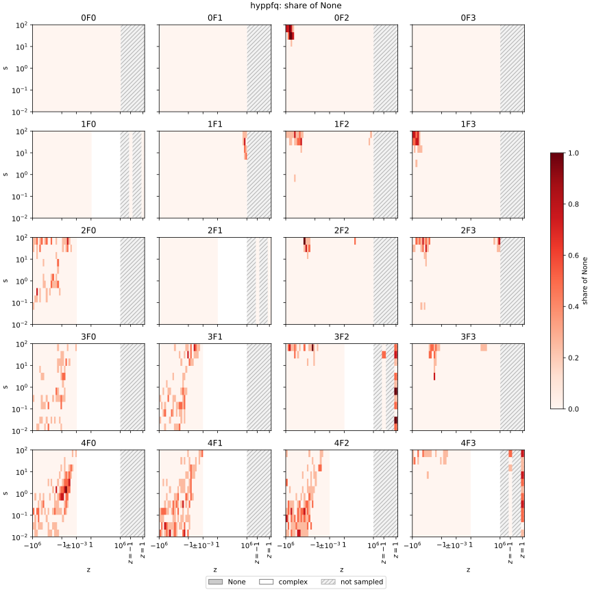
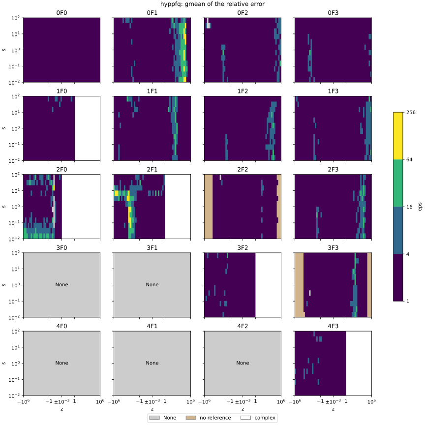
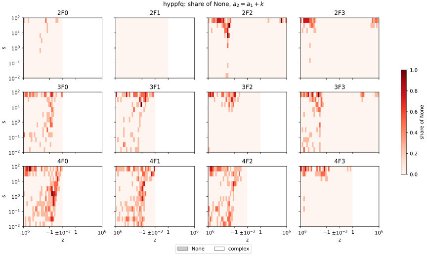
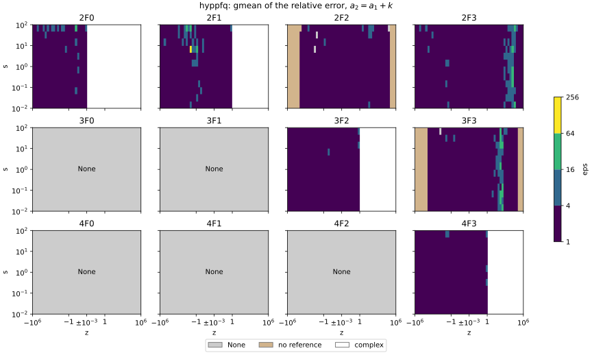

# `hyppfq` map

Where [`hyppfq`](https://docs.rs/xsf/latest/xsf/fn.hyppfq.html) returns `None`, and its relative
error versus the references of [`docs/accuracy.md`](accuracy.md) elsewhere, for $`p \le 4`$ and
$`q \le 3`$.

| axis | values                                                                                                                               |
| ---- | ------------------------------------------------------------------------------------------------------------------------------------ |
| x    | $`z`$, on a signed log scale with $`10^{-3} \le \lvert z \rvert \le 10^6`$, below 1 for $`p = q + 1`$, and below 0 for $`p > q + 1`$ |
| y    | the scale $`s`$ from $`10^{-2}`$ to $`10^2`$, with each $`a_i`$ and $`b_j`$ uniform in $`[-s, s]`$                                   |
| bin  | 4 random inputs                                                                                                                      |
| eps  | the geometric mean of the finite errors of a bin, each at least $`2^{-53}`$, as in `docs/accuracy.md`                                |

Blank bins (complex) hold for generic parameters, not e.g. where the series terminates.

For $`p = q + 1`$, the two narrow columns at the right are the single points $`z = -1`$ and $`z = 1`$.

Generated by [`tools/accuracy/pfq_map.py`](../tools/accuracy/pfq_map.py) (`just pfq-map`).

The same for $`p \ge 2`$, but with $`a_2 = a_1 + k`$ for a random integer $`k`$ in $`[-3, 3]`$:

